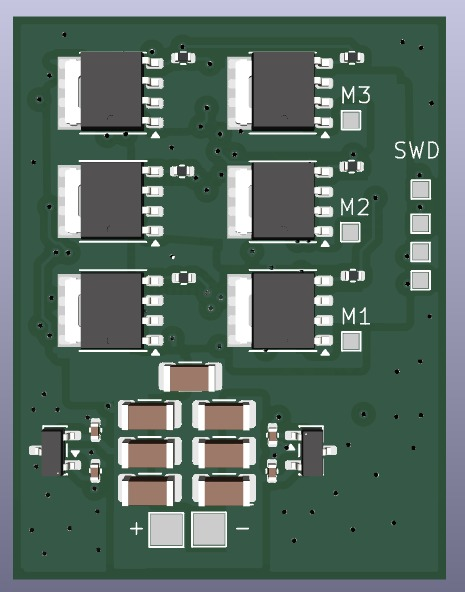
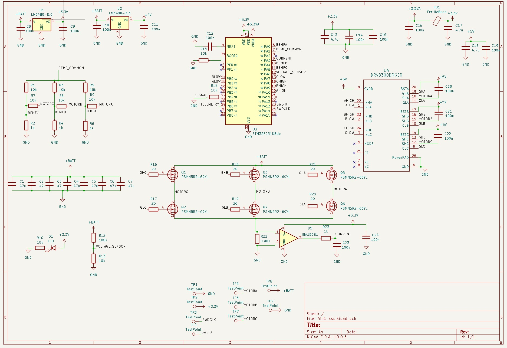
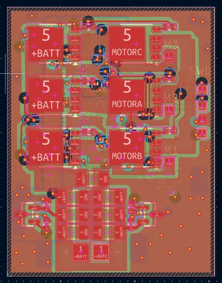
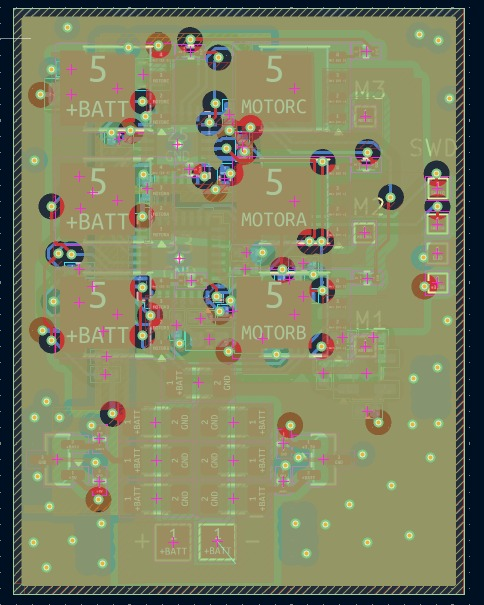
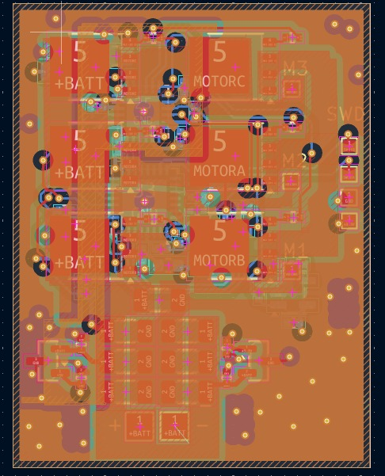
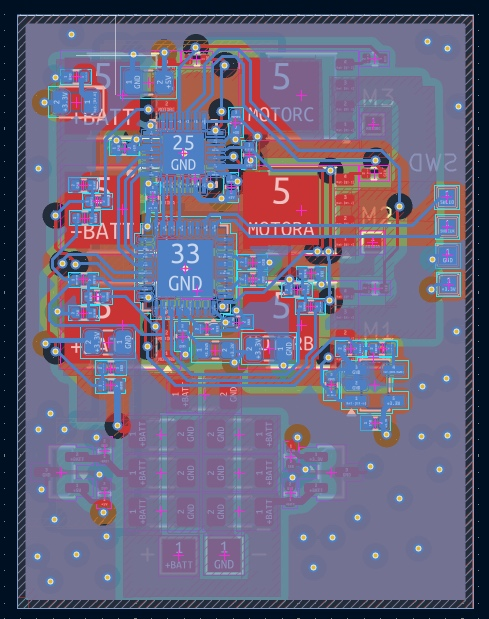
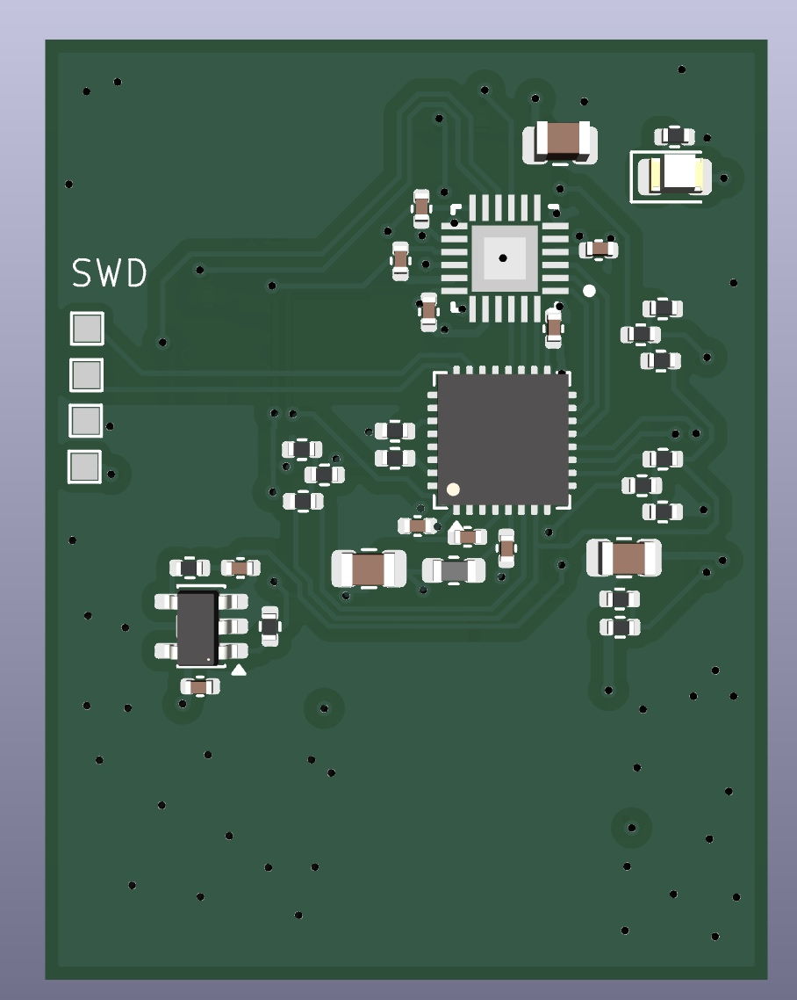

# AM32 Sensorless BLDC ESC — Four-Layer PCB Layout

A four-layer PCB implementation of the AM32 sensorless ESC reference design, built around an STM32F051 microcontroller, TI DRV8300 three-phase gate driver and six-MOSFET bridge.

[View the full interactive project page](https://zceeamt.github.io/#esc)

## Scope and contribution

The electrical architecture follows the AM32 reference schematic; I did not originate the schematic. My contribution was translating that architecture into a manufacturable four-layer KiCad layout and resolving the placement, high-current routing, mixed-signal separation, grounding and thermal constraints around the power stage and control circuitry.

The completed layout incorporates an STM32F051, DRV8300 gate driver, six-MOSFET three-phase bridge, back-EMF network, current sensing and battery-voltage monitoring. This repository documents design work only; the PCB has not been fabricated or validated in hardware.

## Power stage

In the AM32 reference architecture, six **Nexperia PSMN5R2-60YL 60 V MOSFETs** form three half-bridges. The **DRV8300** supplies the high-side and low-side gates, with bootstrap capacitors for the high-side channels and 20 Ω gate resistors to control switching edges and ringing.

Seven 47 µF capacitors provide a low-impedance reservoir close to the bridge for its pulsed current demand.

## Reference control and measurement architecture

- Each phase voltage is attenuated into the STM32 ADC.
- A resistor network produces a virtual neutral reference.
- Zero-crossing of the undriven phase determines the commutation timing.
- A 1 mΩ low-side shunt and INA180 amplifier measure phase current.
- A resistive divider monitors battery voltage.
- Separate LM3480 regulators provide 5 V and 3.3 V rails.
- A ferrite bead isolates the analogue supply.
- Throttle input, telemetry output, SWD and test points support integration and debugging.

## Four-layer PCB implementation

The power stage occupies the top side and the control circuitry the underside. This separates high-dv/dt switching nodes from the sensitive sensing and control paths. Battery and phase currents use wide copper pours, while an array of 0.2 mm thermal vias beneath the gate driver's exposed pad conducts heat into the internal planes.

The design uses 0.15 mm clearance and 0.3 mm vias on 0.6 mm pads, keeping it compatible with standard PCB fabrication capabilities.

| Top layer | Inner layer 1 |
|---|---|
|  |  |

| Inner layer 2 | Bottom layer |
|---|---|
|  |  |

| Top render | Bottom render |
|---|---|
|  |  |

## Technical summary

| Item | Specification |
|---|---|
| Microcontroller | STM32F051, Arm Cortex-M0 |
| Gate driver | TI DRV8300, three-phase |
| MOSFETs | Six Nexperia PSMN5R2-60YL, 60 V |
| Commutation | Sensorless back-EMF with virtual neutral |
| Current sensing | 1 mΩ shunt and INA180 |
| Voltage sensing | Battery divider |
| Regulation | LM3480 5 V and 3.3 V rails |
| Bulk capacitance | Seven 47 µF capacitors |
| Interfaces | Throttle, telemetry and SWD |
| PCB | Four layers, 0.15 mm clearance, 0.3/0.6 mm vias |
| Source architecture | AM32 reference schematic |
| Contribution | Component placement and four-layer PCB routing |
| Status | Layout complete; not fabricated or hardware-tested |

## Skills demonstrated

High-current PCB routing, mixed-signal partitioning, four-layer stack-up, grounding, thermal-via design, KiCad and design for manufacture.

> This repository documents my PCB-layout implementation of the AM32 reference schematic; it does not claim authorship of the circuit architecture or completed hardware validation.
